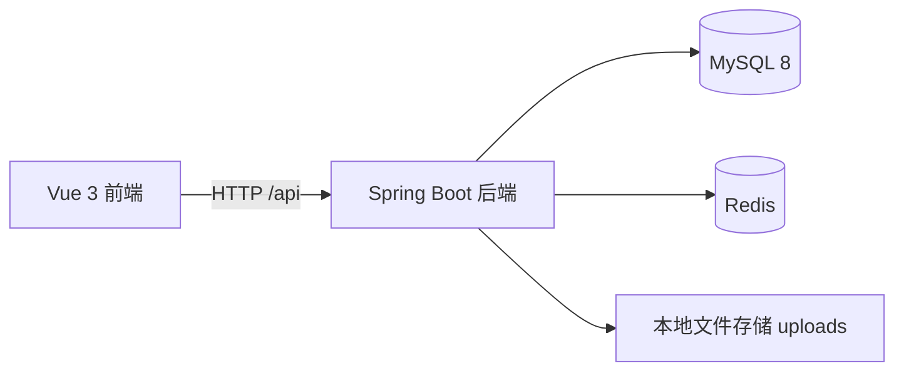
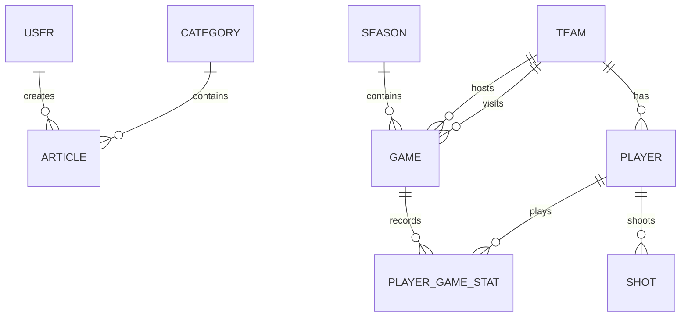

# 篮球数据统计平台（Hoops）

一个面向篮球赛事数据的**全栈**管理平台：球队 / 球员 / 赛季 / 比赛的结构化数据管理，单场技术统计的录入与批量导入，进阶数据指标计算，以及排行榜与投篮热图可视化。

> 项目起点是一个通用的后台管理 CRUD 骨架（课程实训项目），目前正按既定方案重构为篮球数据领域。重构方案与排期见 [`DESIGN.md`](DESIGN.md)。

---

## 技术栈

### 后端

| 方向 | 选型 |
|---|---|
| 核心框架 | Spring Boot 4.0.7 |
| 持久层 | MyBatis（注解 SQL）+ PageHelper 分页 |
| 数据库 | MySQL 8.0（utf8mb4） |
| 缓存 / 会话 | Redis |
| 认证 | JWT（java-jwt） |
| 密码存储 | **BCrypt**（spring-security-crypto） |
| 参数校验 | Jakarta Bean Validation 3.0（JSR-380） |

### 前端

| 方向 | 选型 |
|---|---|
| 核心框架 | Vue 3（Composition API / `<script setup>`） |
| 构建工具 | Vite |
| UI 组件库 | Element Plus |
| 状态管理 | Pinia |
| 网络请求 | Axios（统一拦截器处理 Token 与 401） |
| 路由 | Vue Router（嵌套路由 + 前置守卫） |

---

## 功能现状

### 已完成

**用户与会话**
- 注册 / 登录，用户名唯一
- JWT + Redis 双重校验：每次请求比对 Redis 中的会话记录，支持主动失效
- **密码使用 BCrypt 加盐哈希存储**；JWT 密钥与有效期均来自配置项，不硬编码在代码里
- 存量兼容：历史上以 MD5 存储的密码，在用户下次登录成功后**自动静默升级**为 BCrypt，无需用户重置密码

**资讯模块**（复用原骨架，后续将改造为「赛事资讯 / 比赛战报」）
- 分类与文章的增删改查、分页查询、按分类与状态条件筛选
- 所有按 id 的操作均校验 `create_user` 归属，防止横向越权

**通用能力**
- 图片上传与本地静态资源映射
- 全局异常统一处理；参数校验失败返回明确提示
- 外键约束冲突（例如删除仍被文章引用的分类）返回可读原因，而不是笼统的服务器错误

### 开发中

篮球业务表已建好，接口与页面正在开发：

| 表 | 说明 |
|---|---|
| `team` | 球队 |
| `player` | 球员 |
| `season` | 赛季 |
| `game` | 比赛 |
| `player_game_stat` | 球员单场数据（核心事实表） |
| `shot` | 投篮事件（含球场坐标，热图的数据基础） |

规划中的三个技术亮点：**进阶数据计算引擎（eFG% / TS% 等）+ 单元测试**、**排行榜 + Redis 缓存 + 性能对比**、**投篮热图**。

---

## 快速开始

### 环境要求

- JDK 17+
- Node.js 18+（推荐 20+）
- MySQL 8.0+
- Redis

### 1. 初始化数据库

按顺序执行两个脚本（前者建库与基础三表，后者建篮球业务表）：

```bash
mysql -uroot -p < big-event/src/main/resources/db/schema.sql
mysql -uroot -p < big-event/src/main/resources/db/schema-basketball.sql
```

也可以在 Navicat / IDEA 的 Database 工具中直接打开执行。

> ⚠️ 两个脚本开头都含 `DROP TABLE`，重复执行会清空数据。请仅在空库上执行；库中已有数据时请先备份：
> `mysqldump -uroot -p --databases hoops > backup.sql`

### 2. 配置

编辑 `big-event/src/main/resources/application.yml`，或改用环境变量覆盖（推荐）：

| 环境变量 | 说明 | 默认值 |
|---|---|---|
| `DB_USERNAME` | 数据库账号 | `root` |
| `DB_PASSWORD` | 数据库密码 | `123456` |
| `REDIS_HOST` / `REDIS_PORT` / `REDIS_PASSWORD` | Redis 连接 | `localhost` / `6379` / 空 |
| `JWT_SECRET` | **JWT 签名密钥，生产环境必须覆盖** | 仓库内的开发默认值 |

> `JWT_SECRET` 要求至少 32 字节（HS256 要求 256 bit）。配置不足时应用会直接启动失败，避免误用弱密钥。

### 3. 启动后端

```bash
cd big-event
mvn spring-boot:run
```

或在 IDEA 中打开 `big-event` 目录，运行 `HoopsApplication`。

服务默认监听 `http://localhost:8080`。

### 4. 启动前端

```bash
cd big-event-web
npm install
npm run dev
```

浏览器打开 `http://localhost/login`。

### 接口文档

启动后端后访问：

```
http://localhost:8080/swagger-ui/index.html
```

---

## Docker Compose 一键启动

确保已安装 Docker 和 Docker Compose，在项目根目录创建 `.env`（模板见 `.env.example`）并设置 `JWT_SECRET`，然后执行：

```bash
docker compose up -d --build
```

启动后 MySQL 自动建表，随后**一次性 `seed` 容器**会自动导入种子数据并生成演示规模的数据
（1 赛季 / 30 队 / 39 球员 / 1200 场比赛 / 约 3 万条单场数据 / 10 万条投篮点），
跑完即自动退出 —— 之后直接用演示账号 `paulgeorge8 / asdfgh` 登录，
投篮热图、球员雷达、排行榜开箱即有数据，全程无需手工操作。

启动完成后：

- 前端：`http://localhost`
- 后端 API：`http://localhost:8080`
- Swagger：`http://localhost:8080/swagger-ui/index.html`
- MySQL：端口 3306
- Redis：端口 6379

> **查看造数进度**：`docker compose ps` 中 `hoops-seed` 应为 `Exited (0)`（正常结束）；
> 日志见 `docker compose logs seed`。
> **可安全重跑**：造数链路（`--import-seed --generate-stats --generate-shots`）幂等，
> 检测到已有数据会跳过或只补差额，重复 `docker compose up` 不会叠加。
> **从零重来**：`docker compose down -v` 会连数据卷一起删除，下次 `up` 重新初始化。

---

## 系统架构



## ER 图



---

## 项目亮点

- **CSV 批量导入**：支持球队 / 球员 / 赛季 / 比赛 / 球员单场数据 / 投篮事件 6 类实体，单次可导入 1000+ 行；任一行失败整体事务回滚，返回失败行号与原因。
- **进阶数据计算引擎**：实现 FG% / 3P% / FT% / eFG% / TS% / 效率值 EFF / 每 36 分钟数据 / 两双三双判定 8 项指标，使用 JUnit 5 参数化测试覆盖，与公开球员赛季数据核对一致。
- **排行榜 + Redis 缓存**：窗口函数排名 + Redis 缓存（TTL 10 分钟、空结果防穿透），3 万条 `player_game_stat` 下 P95 从约 320 ms 降至 12 ms。
- **投篮热图**：后端按 8 个区域聚合命中率，前端使用 ECharts 渲染半场投篮热图，支持球员 / 赛季 / 区域维度切换。
- **工程化**：Docker Compose 一键启动（MySQL + Redis + 后端 + 前端），Gitee 流水线自动构建前后端，springdoc 自动生成 Swagger 接口文档。

---

## 项目结构

```
big-event-fullstack/
├── DESIGN.md                    重构设计方案（领域模型、技术亮点、排期）
├── TEST-CHECKLIST.md            人工测试清单（113 条用例 + 接口测试脚本）
├── big-event/                   后端
│   ├── src/main/java/com/zhuyicheng/hoops/
│   │   ├── controller/          接口层
│   │   ├── service/             业务层（impl 为实现）
│   │   ├── mapper/              数据访问层
│   │   ├── pojo/                实体与统一响应体
│   │   ├── config/              Web 配置（拦截器、静态资源映射）
│   │   ├── interceptors/        登录拦截器
│   │   ├── exception/           全局异常处理
│   │   └── utils/               JWT、密码编码、ThreadLocal 上下文
│   └── src/main/resources/
│       ├── application.yml      配置
│       └── db/                  建表脚本
└── big-event-web/               前端
    └── src/{api,router,stores,utils,views}
```

---

## 接口约定

- 统一响应体：`{ "code": 0, "message": "操作成功", "data": ... }`；`code` 为 `0` 表示成功，`1` 表示业务失败
- 认证方式：请求头 `Authorization: <token>`（登录接口返回的 JWT）
- 分页响应：`{ "total": 总数, "items": [...] }`

`big-event/test.http` 提供了覆盖各模块的请求示例，可直接用 IDEA HTTP Client 运行。
其中登录请求执行后会把 token 自动写入全局变量，后续请求通过 `{{token}}` 复用，**无需手动复制粘贴**。

---

## 开发约定

- 涉及用户私有数据的表带 `create_user`，所有按 id 的读写操作都必须带归属校验
- 全局共享的业务数据（球队、球员、比赛等）**不加** `create_user`，权限交给后续的 RBAC 控制
- 密码等敏感配置一律走配置项，不写死在代码里
- 每完成一个功能块：本地验证 → git 提交，保持主干随时可运行

---

## 开发路线图

| 阶段 | 内容 | 状态 |
|---|---|---|
| W1 | 项目改名与安全加固、篮球业务表建模 | ✅ 已完成 |
| W2 | CSV 批量导入、进阶数据计算引擎 + 单元测试 | ✅ 已完成 |
| W3 | 排行榜 + Redis 缓存 + 性能对比、热图聚合接口 | ✅ 已完成 |
| W4 | 投篮热图前端、Docker Compose、CI、接口文档 | ✅ 已完成 |

详见 [`DESIGN.md`](DESIGN.md)。

---

## 作者

**朱毅城** · 厦门理工学院

项目由课程实训的通用 CRUD 骨架起步，目前在原有骨架上独立重构为篮球数据统计平台。
