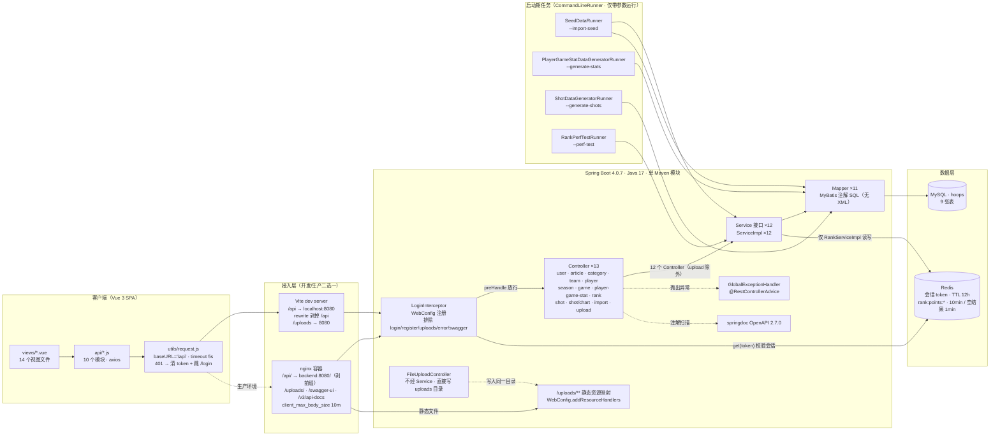
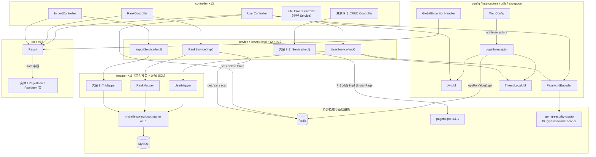

# 逆向工程文档 · Hoops 篮球数据平台

> 对象：`big-event-fullstack`（Spring Boot 4.0.7 + Vue 3 + MySQL + Redis）
> 生成：2026-10-31 · **静态只读分析**（未运行应用、未连接数据库/Redis）
> 方法：每条结论都带源码出处，证据见 [evidence-index.md](evidence-index.md)

本页把两张 Mermaid 图**直接渲染**出来；可编辑源仍保留在 `.mmd` 文件里。

- 架构图源文件：[01-architecture.mmd](01-architecture.mmd)
- 依赖图源文件：[02-module-dependencies.mmd](02-module-dependencies.mmd)
- 证据索引：[evidence-index.md](evidence-index.md)

> **修改约定**：先改 `.mmd`，再把同样内容同步到本页的 `mermaid` 代码块，保持两份一致。

---

## 1. 系统架构

**一句话读法**：浏览器 → `request.js`（baseURL `/api`）→ Vite/nginx 剥掉 `/api` → `LoginInterceptor`（Redis 会话 + JWT 双校验）→ Controller → Service → Mapper → MySQL；排行缓存只在 `RankServiceImpl` 里读写 Redis。

---

## 2. 模块依赖

**一句话读法**：`WebConfig` 注册 `LoginInterceptor`；`LoginInterceptor` 依赖 `JwtUtil` + `ThreadLocalUtil` + Redis；Controller 调 Service，Service 调 Mapper，Mapper 经 MyBatis 访问 MySQL；分页由 7 个 ServiceImpl 调 `PageHelper.startPage`。

---

## 3. 看图的几种方式

| 方式 | 适用 | 说明 |
|---|---|---|
| **Gitee / GitHub 仓库页** | 最省事 | 直接打开本文件，平台通常会自动渲染 `mermaid` 代码块 |
| **IDEA 插件** | 常驻 IDE | `Settings → Plugins` 搜 `Mermaid`，装完双击 `.mmd` 即预览 |
| **VS Code 插件** | 常驻编辑器 | 搜 `Mermaid Editor` 或 `Markdown Preview Mermaid Support` |
| **Mermaid Live** | 零安装、可导出图片 | 打开 <https://mermaid.live>，把 `.mmd` 内容粘进左侧 Code 面板 |

> 如果平台不渲染：说明该平台/版本不支持 Mermaid，改用本地插件或 Mermaid Live 即可，图本身没有损坏。

---

## 4. 已知限制

- 本次是**静态只读分析**：未启动应用、未连接数据库/Redis，因此运行时行为（如路由优先级、缓存实际命中）未验证。
- 未验证项与不确定项统一列在 [evidence-index.md](evidence-index.md) 的 **H 节**。
- 图中「其余 N 个」为概括节点，逐条对应关系未全部核实（见 H6）。
